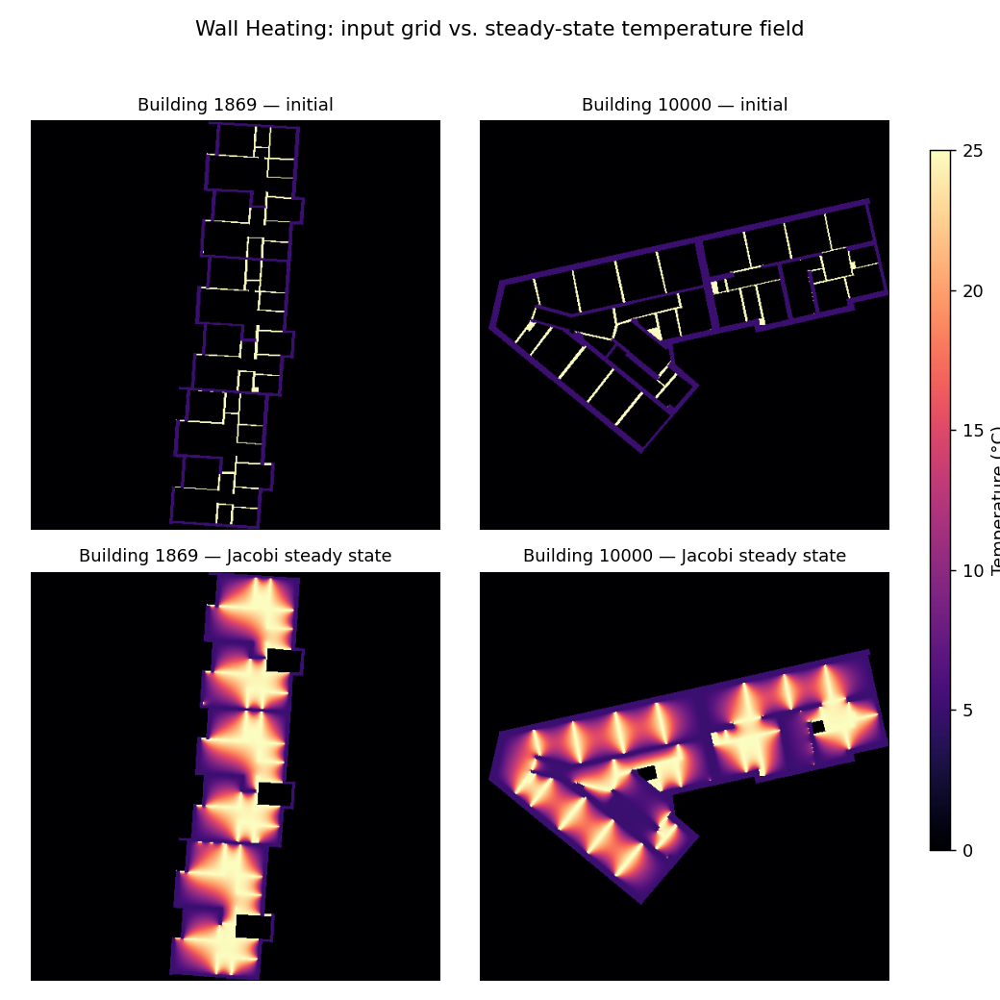

# 🔥 02613 Mini-Project: Wall Heating!

> DTU 02613 *Python and High Performance Computing* 课程小组项目。将一个原本需要 **36+ 小时**的串行 CPU 模拟，通过 profiling 驱动的逐步优化，加速到 **GPU 上几分钟**级别。

## 项目做了什么

课程给出一个虚构的建筑供暖方案 **Wall Heating**：不用暖气片或地暖，而是把承重墙以外的"内墙"整体做成低温辐射面。内墙恒定 25°C，承重墙恒定 5°C，房间内部的温度分布由稳态热传导（Laplace 方程）决定：

```
∂²u/∂x² + ∂²u/∂y² = 0
```

数值上用 **Jacobi 迭代**在 512×512 网格上求解：每个内部格点被反复更新为上下左右四个邻居的平均值，直到收敛（相邻两次迭代最大变化 < 1e-4）或达到最大迭代次数（20000）：

```python
u[i, j] = 0.25 * (u[i+1, j] + u[i-1, j] + u[i, j+1] + u[i, j-1])
```

墙体格点固定不变，建筑外的格点不参与计算。

数据来自 **Modified Swiss Dwellings** 数据集，共 **4571 栋**真实建筑户型图，每栋提供：

- `{id}_domain.npy`：初始温度网格（墙体已赋值，室内为 0）
- `{id}_interior.npy`：二值掩码（1 = 需要迭代求解的室内格点）

## 要解决的问题

课程给出的参考实现 [simulate.py](simulate.py) 用纯 NumPy 串行跑完 4571 栋建筑的估计耗时超过 **一天半**，完全无法用于快速评估 Wall Heating 方案是否可行。项目的目标就是：**在不改变数值结果的前提下，把这个计算尽可能地加速**，从而能对全部 4571 栋建筑逐一求解，并统计：

1. 房间内部的平均温度
2. 房间内部的温度标准差（是否均匀）
3. 高于 18°C 的面积占比（发霉风险区）
4. 低于 15°C 的面积占比（低于人体舒适下限）

## 示例：输入网格 → 稳态求解结果



上排为初始条件（内墙 25°C / 承重墙 5°C / 室内待求解区域为 0），下排为 Jacobi 迭代收敛后的稳态温度场——热量从内墙向房间中央和承重墙附近扩散。

## 优化路线与实测结果

在 DTU HPC 集群（LSF 作业系统）上，针对相同的 50 栋建筑子集，各版本实测总耗时如下：

| 版本 | 脚本 | 计算设备 | 核心思路 | 50 栋建筑耗时 | 相对基准加速比 |
|---|---|---|---|---:|---:|
| 基准参考实现 | [simulate.py](simulate.py) | CPU（单核，NumPy 向量化） | 课程提供的原始实现 | 1445.1 s | 1.0× |
| Numba CUDA 自定义 kernel | [e8.py](e8.py) | GPU | 手写 CUDA kernel，每次迭代只做一步更新，线程间用 kernel 边界同步 | **56.6 s** | **≈25.5×** |
| CuPy 朴素移植 | [e9.py](e9.py) | GPU | 把 NumPy 调用逐行替换为 CuPy | 159.5 s | ≈9.1× |
| CuPy 优化版 | [e10.py](e10.py) | GPU | 用 `cp.fuse()` 融合逐元素运算，减少 kernel 启动次数 | **117.2 s** | ≈12.3× |

（[runtime.py](runtime.py) 另外测得 20 栋建筑单核串行需 200.9 s，可推算处理全部 4571 栋建筑约需 12–37 小时不等，具体取决于建筑复杂度。）

### 用 nsys 定位并修复 CuPy 版本的性能瓶颈

用 `nsys profile` 分析朴素 CuPy 版本（e9）发现，**GPU kernel 启动次数高达 224 万次**、`cudaMemcpyAsync` 调用 47 万次，二者合计占掉了近 90% 的运行时间：

```
Time (%)  Num Calls   Name
  56.4%    2 244 242   cuLaunchKernel
  31.6%      472 532   cudaMemcpyAsync
   3.8%      472 492   cudaStreamSynchronize
```

原因是每次 Jacobi 迭代里，`0.25 * (...)` 和布尔掩码索引 `u[interior_mask]` 被拆成了好几个独立的逐元素 CuPy 算子，每个算子都要单独启动一次 kernel——对于 512×512 的网格，单次 kernel 计算量太小，**kernel 启动开销（launch overhead）远大于实际计算时间**，问题是启动次数太多而不是算力不够。

修复方式（见 [e10.py](e10.py)）：用 `@cp.fuse()` 把四个方向的加权求和融合成一个 kernel，并把掩码更新也改写成一次性的逐元素表达式，减少每次迭代内的 kernel 启动次数，把耗时从 159.5 s 降到 117.2 s（约 **1.36× 加速**）。

## 全量运行结果（4571 栋建筑）

用优化后的 GPU 流水线跑完全部 4571 栋建筑，结果见 [gpu_results.csv](gpu_results.csv)，平均温度分布如下：


| 指标 | 数值 |
|---|---:|
| 建筑总数 | 4571 |
| 平均温度的均值 | 14.71 °C |
| 温度标准差的均值 | 6.80 °C |
| 至少 50% 面积高于 18°C 的建筑数 | 813 |
| 至少 50% 面积低于 15°C 的建筑数 | 2460 |

**结论**：对大多数户型而言，Wall Heating 无法让房间大部分区域达到 18°C 以上的"低发霉风险"标准，反而有超过一半的建筑（2460/4571）有至少一半面积低于 15°C 的舒适下限——单靠加热内墙、不改造承重墙的方案，在这批户型上整体效果有限。

## 仓库结构

```
simulate.py             # 课程提供的参考实现（CPU / NumPy，串行）
runtime.py, runtime.sh  # 基准耗时测量（HPC 批处理作业）
e8.py,  e8.sh            # Numba CUDA 自定义 kernel 版本
e9.py,  e9.sh            # CuPy 朴素移植版本
e10.py, e10.sh           # CuPy 优化版本（cp.fuse 融合 kernel）
e9nsys.out, e10nsys.out  # nsys profiling 报告
visualize.py             # 输入网格 / 求解结果可视化
gpu_results.csv          # 全部 4571 栋建筑的最终统计结果
mean_temp.png            # 平均温度分布直方图
file/                    # 少量示例建筑的 .npy 数据，供本地快速试跑
```

## 如何运行

```bash
# 基准参考实现（本地小样本试跑）
python simulate.py 10

# HPC 上提交 GPU 作业
bsub < e8.sh    # Numba CUDA kernel
bsub < e9.sh    # CuPy 朴素版本
bsub < e10.sh   # CuPy 优化版本
```

数据默认从 DTU HPC 集群路径 `/dtu/projects/02613_2025/data/modified_swiss_dwellings/` 读取；仓库 `file/` 目录下附带了 20 栋建筑的样例数据，方便脱离集群环境本地测试。
