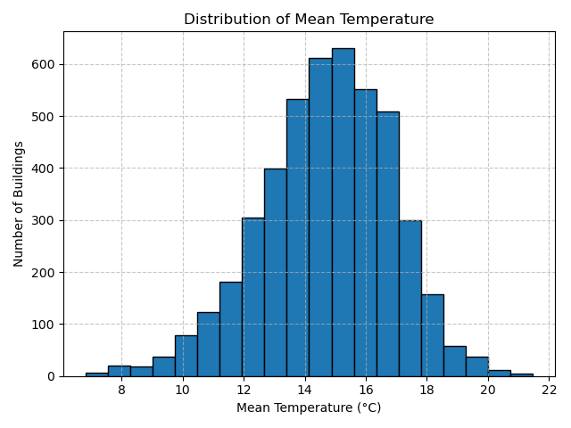
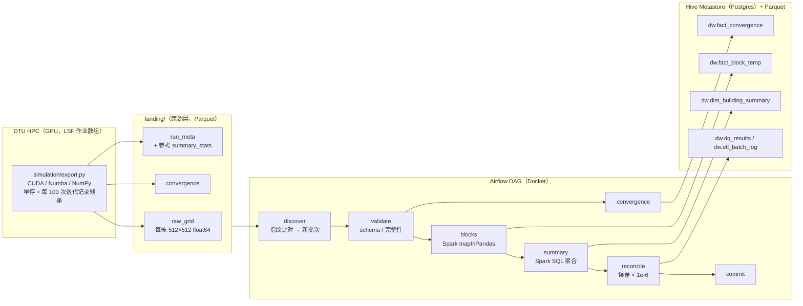
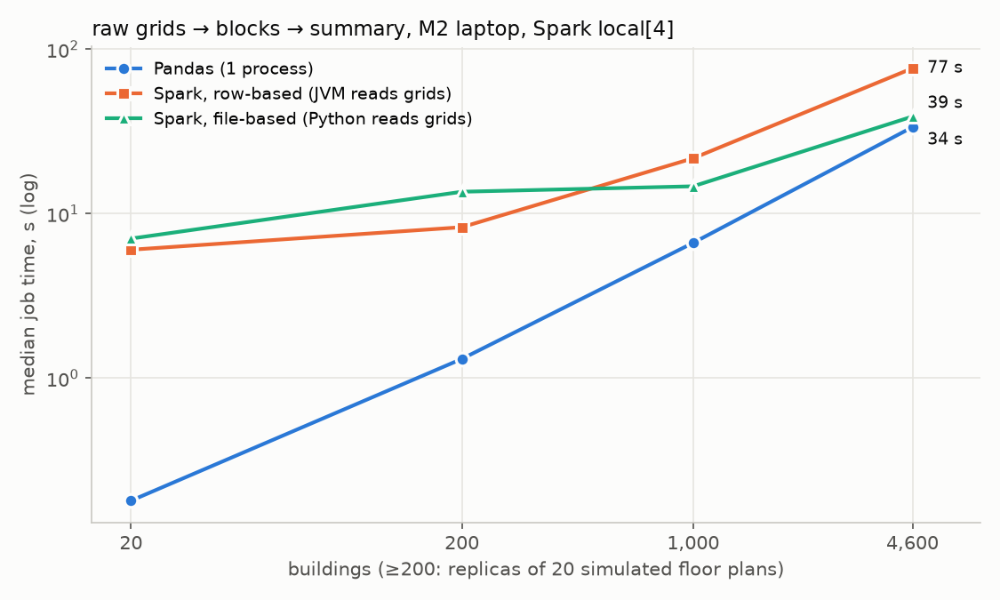

# 🔥 02613 Mini-Project: Wall Heating!

> DTU 02613 *Python and High Performance Computing* 课程小组项目。将一个原本需要 **36+ 小时**的串行 CPU 模拟，通过 profiling 驱动的逐步优化，加速到 **GPU 上几分钟**级别。
>
> **Part 2（[数据工程扩展](#part-2-数据工程扩展)）**：把仿真结果接入一条完整的 ETL 管道——分层 Parquet、PySpark 清洗聚合、Hive 分区入仓、Airflow 增量调度，`docker compose up` 即可在本地跑通。

## 项目做了什么

课程给出一个虚构的建筑供暖方案 **Wall Heating**：不用暖气片或地暖，而是把承重墙以外的"内墙"整体做成低温辐射面。内墙恒定 25°C，承重墙恒定 5°C，房间内部的温度分布由稳态热传导（Laplace 方程）决定：

```
∂²u/∂x² + ∂²u/∂y² = 0
```

数值上用 **Jacobi 迭代**在 512×512 网格上求解：每个内部格点被反复更新为上下左右四个邻居的平均值，直到收敛（相邻两次迭代最大变化 < 1e-4）或达到最大迭代次数（20000）：

```python
u[i, j] = 0.25 * (u[i+1, j] + u[i-1, j] + u[i, j+1] + u[i, j-1])
```

墙体格点固定不变，建筑外的格点不参与计算。

数据来自 **Modified Swiss Dwellings** 数据集，共 **4571 栋**真实建筑户型图，每栋提供：

- `{id}_domain.npy`：初始温度网格（墙体已赋值，室内为 0）
- `{id}_interior.npy`：二值掩码（1 = 需要迭代求解的室内格点）

## 要解决的问题

课程给出的参考实现 [simulate.py](simulation/simulate.py) 用纯 NumPy 串行跑完 4571 栋建筑的估计耗时超过 **一天半**，完全无法用于快速评估 Wall Heating 方案是否可行。项目的目标就是：**在不改变数值结果的前提下，把这个计算尽可能地加速**，从而能对全部 4571 栋建筑逐一求解，并统计：

1. 房间内部的平均温度
2. 房间内部的温度标准差（是否均匀）
3. 高于 18°C 的面积占比（发霉风险区）
4. 低于 15°C 的面积占比（低于人体舒适下限）

## 示例：输入网格 → 稳态求解结果


上排为初始条件（内墙 25°C / 承重墙 5°C / 室内待求解区域为 0），下排为 Jacobi 迭代收敛后的稳态温度场——热量从内墙向房间中央和承重墙附近扩散。

## 优化路线与实测结果

在 DTU HPC 集群（LSF 作业系统）上，针对相同的 50 栋建筑子集，各版本实测总耗时如下：

| 版本 | 脚本 | 计算设备 | 核心思路 | 50 栋建筑耗时 | 相对基准加速比 |
|---|---|---|---|---:|---:|
| 基准参考实现 | [simulate.py](simulation/simulate.py) | CPU（单核，NumPy 向量化） | 课程提供的原始实现 | 1445.1 s | 1.0× |
| Numba CUDA 自定义 kernel | [e8.py](simulation/e8.py) | GPU | 手写 CUDA kernel，每次迭代只做一步更新，线程间用 kernel 边界同步 | **56.6 s** | **≈25.5×** |
| CuPy 朴素移植 | [e9.py](simulation/e9.py) | GPU | 把 NumPy 调用逐行替换为 CuPy | 159.5 s | ≈9.1× |
| CuPy 优化版 | [e10.py](simulation/e10.py) | GPU | 用 `cp.fuse()` 融合逐元素运算，减少 kernel 启动次数 | **117.2 s** | ≈12.3× |

（[runtime.py](simulation/runtime.py) 另外测得 20 栋建筑单核串行需 200.9 s，可推算处理全部 4571 栋建筑约需 12–37 小时不等，具体取决于建筑复杂度。）

### 用 nsys 定位并修复 CuPy 版本的性能瓶颈

用 `nsys profile` 分析朴素 CuPy 版本（e9）发现，**GPU kernel 启动次数高达 224 万次**、`cudaMemcpyAsync` 调用 47 万次，二者合计占掉了近 90% 的运行时间：

```
Time (%)  Num Calls   Name
  56.4%    2 244 242   cuLaunchKernel
  31.6%      472 532   cudaMemcpyAsync
   3.8%      472 492   cudaStreamSynchronize
```

原因是每次 Jacobi 迭代里，`0.25 * (...)` 和布尔掩码索引 `u[interior_mask]` 被拆成了好几个独立的逐元素 CuPy 算子，每个算子都要单独启动一次 kernel——对于 512×512 的网格，单次 kernel 计算量太小，**kernel 启动开销（launch overhead）远大于实际计算时间**，问题是启动次数太多而不是算力不够。

修复方式（见 [e10.py](simulation/e10.py)）：用 `@cp.fuse()` 把四个方向的加权求和融合成一个 kernel，并把掩码更新也改写成一次性的逐元素表达式，减少每次迭代内的 kernel 启动次数，把耗时从 159.5 s 降到 117.2 s（约 **1.36× 加速**）。

## 全量运行结果（4571 栋建筑）

用优化后的 GPU 流水线跑完全部 4571 栋建筑，结果见 [gpu_results.csv](results/gpu_results.csv)，平均温度分布如下：



| 指标 | 数值 |
|---|---:|
| 建筑总数 | 4571 |
| 平均温度的均值 | 14.71 °C |
| 温度标准差的均值 | 6.80 °C |
| 至少 50% 面积高于 18°C 的建筑数 | 813 |
| 至少 50% 面积低于 15°C 的建筑数 | 2460 |

**结论**：对大多数户型而言，Wall Heating 无法让房间大部分区域达到 18°C 以上的"低发霉风险"标准，反而有超过一半的建筑（2460/4571）有至少一半面积低于 15°C 的舒适下限——单靠加热内墙、不改造承重墙的方案，在这批户型上整体效果有限。


---

# Part 2: 数据工程扩展

在 HPC 仿真的基础上补一条完整的数据管道：**仿真结果 → 分层 Parquet → PySpark 清洗聚合 → Hive 分区入仓 → Airflow 增量调度**。原来的课程版本每栋建筑只输出 4 个数字；这里保留完整的温度场，再由 ETL 拆成区块明细、收敛日志和建筑汇总三张表。

## 架构



全量 4,571 栋建筑的仿真在 DTU 的 GPU 节点（`gpua10` 队列）上跑：[simulation/export_job.sh](simulation/export_job.sh) 提交 23 个数组任务，每个任务 200 栋，全部一次成功。每栋平均求解 0.45 s，99.76% 的建筑在 2 万次迭代内收敛，共写出 2.6 GB 原始层。本地 Docker 环境中，DAG 的第一个任务用 Numba 在 CPU 上计算仓库自带的 20 栋样例建筑，所以不需要 GPU 也能跑通整条管道。

## 数据模型

| 层 | 表 | 粒度 | 全量实测（4,571 栋，23 批） | 样例（20 栋） |
|---|---|---|---:|---:|
| 原始 | landing/raw_grid | 每栋建筑 1 行（2 MB 温度场 + 掩码） | 4,571 行，2.6 GB | 20 |
| 原始 | landing/convergence | 每栋 × 每 100 次迭代 | 399,751 行 | 1,467 |
| 清洗 | dw.fact_block_temp | 每栋 × 含室内格点的 32×32 区块 | 539,744 行，23 MB | 2,091 |
| 清洗 | dw.fact_convergence | 同 landing | 399,751 行，9.6 MB | 1,467 |
| 汇总 | dw.dim_building_summary | 每栋 1 行 | 4,571 行，0.5 MB | 20 |
| 运维 | dw.dq_results、dw.etl_batch_log | 批次 × 检查项 / 批次 | 345 / 23 | 60 / 4 |

清洗后的数仓总共约 33 MB，是原始层的 1/80。每张表每个批次只有 1 个 Parquet 文件。

字段定义、单位和清洗规则见 [docs/data_dictionary.md](docs/data_dictionary.md)。几个关键设计：

- **区块表只存可加的度量**（格点数、温度和、温度平方和、超阈值格点数），这样汇总表能精确还原标准差和面积占比。如果只存区块的均值、最小值、最大值，这两项是算不出来的。
- **所有表按 `batch_id` 分区，写入方式是 `INSERT OVERWRITE` + 动态分区覆盖。** 重跑某个批次只替换这一个分区，不会产生重复行。
- **分档用固定阈值，不用分位数。** 如果用分位数，新批次到来后旧建筑的分档会跟着变，重跑结果就不再幂等。

## 数据质量与对账

每个阶段的检查结果都写入 `dw.dq_results`，状态分为 PASS / WARN / FAIL。出现 FAIL 时任务以退出码 2 结束，Airflow 会重试并在日志中告警；该批次不会被 commit，下一次调度时会自动重新处理。

| 检查 | 阶段 | 结果（全量 4,571 栋） |
|---|---|---|
| landing schema 与预期完全一致 | validate | PASS |
| 温度场字节长度、建筑在三张表之间的完整性、重复 ID | validate | PASS（在样例上注入一条截断的温度场后正确 FAIL，退出码 2） |
| 未收敛：跑满 2 万次迭代仍未达到 atol | validate | **WARN：11 栋，分布在 8 个批次** |
| 室内温度落在物理范围 [0, 25] °C 内且不为 NaN，否则整栋建筑进入隔离表 | blocks | PASS（隔离 0 栋） |
| 掩码泄漏：室内格点紧邻建筑外部（0 °C）而非墙体 | blocks | **WARN：3,851 栋（84%）** |
| **Spark 汇总 vs 仿真脚本的 `summary_stats()`，逐栋比对** | reconcile | **4,571/4,571 一致，最大绝对误差 6.7×10⁻¹⁴（阈值 1×10⁻⁶）** |

`dq_results` 共 345 行：314 PASS，31 WARN，0 FAIL。

**和课程部分的结果交叉验证：** [results/gpu_results.csv](results/gpu_results.csv) 是课程部分在 GPU 上跑出的结果，和数仓里的 4,571 栋逐栋对比，平均温度差异中位数为 0.018 °C，最大 0.076 °C。差异来自停止条件：课程的 GPU 版本（如 [e8.py](simulation/e8.py)）固定跑满 2 万次迭代，这里每 100 次迭代检查一次残差，低于 atol = 1e-4 就停止。两边的结论一致：至少一半面积高于 18 °C 的建筑分别是 813 栋和 804 栋，至少一半面积低于 15 °C 的分别是 2,460 栋和 2,471 栋。

> 掩码泄漏这一项最初是写成 FAIL 的："室内温度必须在 5–25 °C 之间（承重墙最冷 5 °C）"。结果第一次跑就把 20 栋里的 16 栋隔离了。排查后发现，部分室内格点直接挨着建筑外部（固定为 0 °C）而不是挨着墙，参考实现本身就会在这些地方算出低于 5 °C 的温度。也就是说，这是数据本身的特征，不是 bug。于是把物理范围修正为 [0, 25]，并把这种情况改为 WARN 单独统计。

## 性能结果

所有数字都在同一台机器上测得：M2 MacBook Air，4 个性能核 + 4 个能效核，无风扇。每项跑 3 次取中位数，原始数据见 [benchmarks/results/](benchmarks/results/)。

### Spark vs Pandas

工作内容：原始温度场 → 区块统计 → 清洗 → 建筑汇总，写出 Parquet。三个引擎的结果逐栋一致（最大差异 4×10⁻¹⁴）。≥ 200 栋的数据集由 20 栋真实仿真结果复制而成（`building_id` 加 `_rK` 后缀，见 [benchmarks/make_scaled.py](benchmarks/make_scaled.py)），用来测量引擎开销随数据量的变化，**不是新的仿真结果**。



| 建筑数 | 原始 Parquet | Pandas（单进程） | Spark 按行读取 | Spark 按文件读取 |
|---:|---:|---:|---:|---:|
| 20 | 10 MB | 0.2 s | 6.0 s | 7.1 s |
| 200 | 106 MB | 1.3 s | 8.3 s | 13.6 s |
| 1,000 | 527 MB | 6.7 s | 21.7 s | 14.7 s |
| 4,600 | 2.4 GB | **33.6 s** | 76.6 s | 39.0 s |

结论（如实记录）：

1. **单机上 Spark 没有超过 Pandas。** 在全量规模（约 4,600 栋）下，Spark 仍比单进程 Pandas 慢 16%。Spark 有大约 6 s 的固定开销（JVM 启动、任务调度、Arrow 序列化），差距从 20 栋时的 30 多倍缩小到 4,600 栋时的 1.16 倍。用 1,000 和 4,600 栋两个点做线性外推，Spark 每栋的边际成本略低（6.75 ms，Pandas 为 7.49 ms），在这台笔记本上大约要到 1.2 万栋才会持平，已经超过了全量数据集的规模。Spark 真正的优势在于数据超出单机内存或需要多节点时；本项目全量真实原始层为 2.6 GB，一台机器装得下。
2. **按文件读取比按行读取快 2.0 倍（76.6 s → 39.0 s）。** 按行读取时，由 JVM 读取并解压每栋 2 MB 的温度场，再通过 Arrow 发送给 Python worker，相当于在进程之间搬运约 9.6 GB 数据。按文件读取时，Spark 只分发 `(文件, row group)` 任务单元，由 Python worker 直接用 pyarrow 读取。按 row group 而不是按文件切分，可以避免大文件导致的任务倾斜。
3. **核数不是越多越好。** 在这台机器上，用 multiprocessing 实测：4 进程比 1 进程快 3.3 倍，8 进程反而更慢，因为能效核会拖后腿。因此默认配置为 `local[4,3]`。逗号后的 3 表示每个任务最多尝试 3 次：本地模式默认不重试，一个 Python worker 崩溃就会让整个作业失败，这个问题在测试中确实出现过。

### 分区方案对比

查询语句见 [warehouse/queries.sql](warehouse/queries.sql)。同一批查询在两份数据上各测了一次：

- **全量真实数据**：54 万行区块表、4,571 行汇总表，每批 200 栋，结果见 [partition_bench.csv](benchmarks/results/partition_bench.csv)。
- **复制数据**：48 万行区块表，每批只有 5 栋，结果见 [partition_bench_replicated.csv](benchmarks/results/partition_bench_replicated.csv)。

| 查询 | 不分区 | 按 batch_id 分区 | 按 temp_band 分区 |
|---|---:|---:|---:|
| q3 温暖建筑中的冷区块（全表扫描 + 过滤） | 59 ms | 65 ms（23 个文件） | 52 ms（裁剪生效） |
| q4 大户型热力图（全表扫描） | 106 ms | 87 ms | 85 ms |
| q5 单个批次（`batch_id = 7`） | 55 ms | 45 ms（裁剪生效） | 62 ms |
| *复制数据：q3，按 batch_id 分区* | *114 ms（3 个文件）* | *989 ms（920 个文件）* | *168 ms* |

- **小文件问题，实测：** 复制数据集每批只有 5 栋建筑，按 `batch_id` 分区后产生 920 个小文件，全表扫描慢了约 8.7 倍。真实数据每批 200 栋，只有 23 个文件，全表扫描和不分区基本一样快（65 ms 对 59 ms）。所以批次大小定为 200 栋，而不是更小；并且每个写入任务都先 `repartition('batch_id')`，保证每个分区只有一个文件。
- **在这个数据量下，分区裁剪对延迟影响很小**（q5 快了约 18%），查询时间主要是固定开销。按 `batch_id` 分区的真正价值在于增量写入时的幂等覆盖，而不是查询加速。4,571 行的汇总表完全不需要分区。

### 调度（Airflow，Docker）

| 指标 | 实测 |
|---|---|
| **全量 DAG 端到端（4,571 栋，23 个批次，2.6 GB 原始层）** | **2 分 50 秒**，各表行数与本地运行完全一致 |
| 本地 CLI `etl.run all`，全量 | 59 s（validate 19 s，blocks 19 s，convergence 7 s，summary + reconcile + commit 4 s） |
| DAG 端到端（20 栋样例，4 个批次，含 Numba 仿真） | 2 分 26 秒 |
| 无新批次时重新触发 | 所有 Spark 任务被跳过（ShortCircuit） |
| 只修改一个批次后重跑 | 只重新处理该批次；各表行数不变，无重复行 |

## 如何运行

```bash
# 1) 一键启动：Postgres + Hive Metastore 3.1.3 + Airflow（内含 Spark 4 local 模式）
docker compose up -d --build
#    打开 http://localhost:8080（admin / admin），DAG hpc_temp_etl 会自动运行

# 2) 不用 Docker：本地 venv（需要 Java 17/21），使用内嵌的 Derby metastore
python -m venv .venv && .venv/bin/pip install -r requirements.txt
.venv/bin/python simulation/export.py --data-dir data/sample --out-dir data/landing --batch-size 5
PYTHONPATH=. .venv/bin/python -m etl.run all          # 只处理新增或有变化的批次
PYTHONPATH=. .venv/bin/python -m pytest tests

# 3) 全量仿真（DTU HPC，在仓库根目录执行）
bash simulation/setup_gpu_env.sh                     # 只需一次，在 GPU 节点上建 ~/venv-gpu（numba-cuda）
python simulation/diagnose_cuda.py                   # 可选：逐步检查 CUDA 环境
mkdir -p logs && bsub < simulation/export_job.sh     # 23 个数组任务，每个任务 200 栋
#    拷回本地：rsync -av --partial <user>@login.hpc.dtu.dk:~/Python-HPC/data/landing/ data/landing/
#    在 Airflow 里手动触发并设 {"simulate_sample": false}，或者直接跑 etl.run all

# 4) 复现性能结果
PYTHONPATH=. .venv/bin/python benchmarks/make_scaled.py --factor 10 50 230
PYTHONPATH=. .venv/bin/python benchmarks/spark_vs_pandas.py --datasets data/landing data/scaled/x{10,50,230}/landing
PYTHONPATH=. .venv/bin/python benchmarks/partition_bench.py --input data/lake/dw   # 全量真实数仓
.venv/bin/python benchmarks/plot.py
```

课程部分的脚本（`simulate.py`、`e8`–`e10`）仍从 DTU 集群路径 `/dtu/projects/02613_2025/data/modified_swiss_dwellings/` 读取数据，需要在 `simulation/` 目录下提交：`cd simulation && bsub < e8.sh`。

## 踩过的坑

| 问题 | 原因 | 处理 |
|---|---|---|
| `Invalid method name: 'get_table'` | Hive Metastore 4 删除了 Spark 内置 Hive 2.3 客户端仍在调用的旧版 Thrift 接口 | 改用 HMS 3.1.3 |
| `authentication type 10 is not supported` | Hive 3.1.3 镜像自带 2016 年的 Postgres 驱动，不支持 SCRAM 认证 | 在镜像中替换为 42.7 版驱动 |
| `Repetition level histogram size mismatch` | landing 文件由 pyarrow 20 写出，Airflow 镜像里的 pyarrow 19 读不了新版 Parquet 统计信息 | 读写两端固定为同一版本 |
| 复制数据集多出一个 `batch_id` 列 | 当路径中包含 `batch_id=…` 时，`pq.read_table(path)` 会自动加上 Hive 分区列 | 改用 `ParquetFile.read()` |
| 偶发 `Python worker exited unexpectedly` | 本地模式默认不重试失败的任务 | 设置 `local[N,3]`，并开启 faulthandler |
| HPC 上 23 个 GPU 任务全部 segfault（退出码 139） | 同一进程里先后用 CuPy 和 Numba 创建 CUDA 上下文会冲突 | CUDA 后端只用 Numba，残差也改成 Numba kernel（共享内存归约 + `atomic.max`） |
| 去掉 CuPy 后仍然 segfault，连课程自己的 e8.py 也崩溃 | 课程环境的 Numba 0.58.1 与节点上更新后的 CUDA 驱动不兼容（[diagnose_cuda.py](simulation/diagnose_cuda.py) 定位到：活动上下文的设备号显示为 254，而节点只有 1 块 GPU） | 用 [setup_gpu_env.sh](simulation/setup_gpu_env.sh) 建独立 venv，装 `numba-cuda[cu12]`，它自带 CUDA 12 运行库 |
| numba-cuda 报 `TypingError: shared.array(int64, ...)` | 新版类型系统要求共享内存数组的大小是编译期常量，kernel 内的 `TPB * TPB` 被当成运行时值 | 改成模块级常量 `BLOCK_THREADS`，dtype 用 `np.float64` |

## 仓库结构

```
simulation/        课程代码（simulate.py、e8–e10、*.sh、logs/）+ export.py（ETL 入口）+ export_job.sh
etl/               blockstats.py（区块统计核心）、transforms.py（Spark 变换）、run.py（各阶段 CLI）、
                   pandas_baseline.py、config.py
warehouse/         ddl.sql（Hive 外部表）、queries.sql（分析查询）
dags/              hpc_temp_etl.py（Airflow DAG）
benchmarks/        Spark vs Pandas、分区对比、复制数据集生成、画图；results/ 下是原始结果
docker/            Airflow / Hive 镜像，Postgres 初始化脚本
docs/              data_dictionary.md、图片
tests/             区块 → 汇总等价性、编解码往返、NaN 检测、Numba 与 NumPy 逐位一致
data/sample/       20 栋样例建筑（.npy）
results/           课程部分 4,571 栋建筑的 GPU 结果
```
